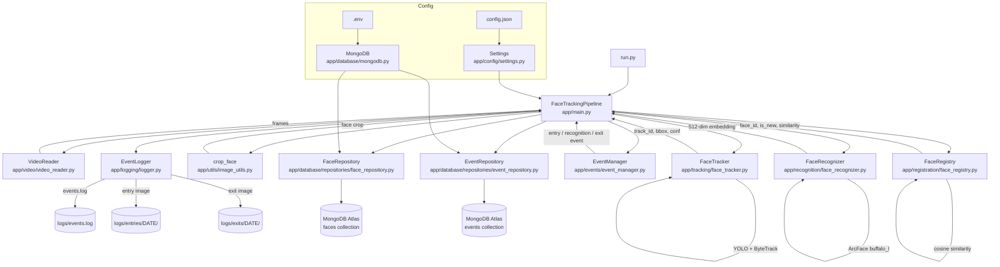

# Architecture — Intelligent Face Tracker

## Component Diagram (Mermaid)



---

## ASCII Architecture (fallback)

```
run.py
  └── FaceTrackingPipeline (app/main.py)
        │
        ├── [Config]
        │     ├── Settings          ← config.json
        │     └── MongoDB           ← .env (MONGODB_URI)
        │
        ├── [Per-video loop]
        │     ├── VideoReader       reads frames (generator)
        │     └── FaceTracker       YOLO detect + ByteTrack
        │                           → track_id, bbox
        │
        ├── [Per-track (new track_id only)]
        │     ├── crop_face         image_utils.py
        │     ├── FaceRecognizer    ArcFace → 512-dim embedding
        │     └── FaceRegistry      cosine similarity → face_id
        │                           auto-register if new
        │
        ├── [Per-track (every frame)]
        │     └── EventManager      entry / recognition / exit
        │                           unique visitor set
        │
        └── [Event dispatch]
              ├── EventLogger       events.log + image files
              ├── FaceRepository    MongoDB faces collection
              └── EventRepository   MongoDB events collection
```

---

## Key Data Flows

### New face first appearance

```
frame → FaceTracker → [track_id=5, bbox]
      → crop_face → 112×112 face image
      → FaceRecognizer → 512-dim embedding
      → FaceRegistry.identify()
            → get_all_faces() from MongoDB
            → cosine similarity < 0.6 → register new
            → return FACE_ABCD1234, is_new=True
      → track_to_face[5] = "FACE_ABCD1234"
      → EventManager.process_seen_face("FACE_ABCD1234", 5)
            → entry event (is_new_visitor=True)
      → EventLogger.save_image(crop, "entry", face_id)
      → EventRepository.save_event(entry, ...)
```

### Known face on subsequent frame

```
frame → FaceTracker → [track_id=5, bbox]
      → track_to_face[5] exists → face_id = "FACE_ABCD1234"
      → EventManager.process_seen_face("FACE_ABCD1234", 5)
            → recognition event
      → EventLogger.log("recognition", face_id)
      → EventRepository.save_event(recognition, ...)
      (no embedding generated — cached mapping reused)
```

### Exit detection

```
Processed frame N: FACE_ABCD1234 not in visible_face_ids
→ EventManager.process_missing_faces({})
      → missing_frames counter += 1
      → if missing_frames >= 15 → exit event

→ EventLogger.save_image(last_crop["FACE_ABCD1234"], "exit", face_id)
→ EventLogger.log("exit", face_id)
→ EventRepository.save_event(exit, ...)
→ del active_faces["FACE_ABCD1234"]
```

---

## Identity vs Track ID

```
Track ID (ByteTrack)          Face ID (ArcFace)
─────────────────────         ──────────────────────────
Temporary integer             Persistent FACE_XXXXXXXX
Local to one video            Persisted in MongoDB
Resets between videos         Survives across videos
May be reused by new person   Always maps to same person
```

The `track_to_face` dict bridges these two namespaces. It is reset for every new video to prevent false identity continuity.

---

## MongoDB Collections

### faces
| Field | Type | Description |
|---|---|---|
| face_id | string | Unique identifier e.g. `FACE_3A1B2C3D` |
| embedding | array[float] | 512-dim ArcFace embedding |
| image_path | string / null | Path to registration image (if saved) |
| created_at | datetime | UTC registration timestamp |

Index: `face_id` (unique)

### events
| Field | Type | Description |
|---|---|---|
| face_id | string | Reference to faces.face_id |
| event_type | string | `registration`, `entry`, `recognition`, `exit` |
| timestamp | datetime | UTC event time |
| image_path | string / null | Path to entry or exit image |
| track_id | int / null | ByteTrack ID at time of event |
| video_filename | string | Source MP4 filename |

Indexes: `face_id`, `timestamp`
